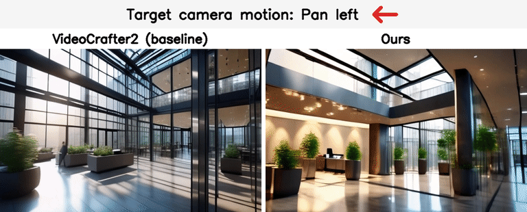
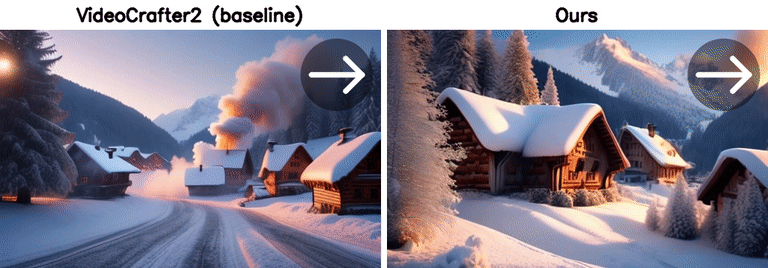
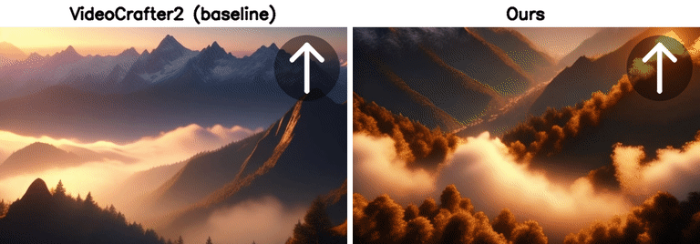
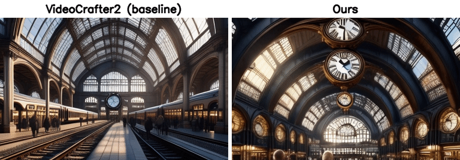
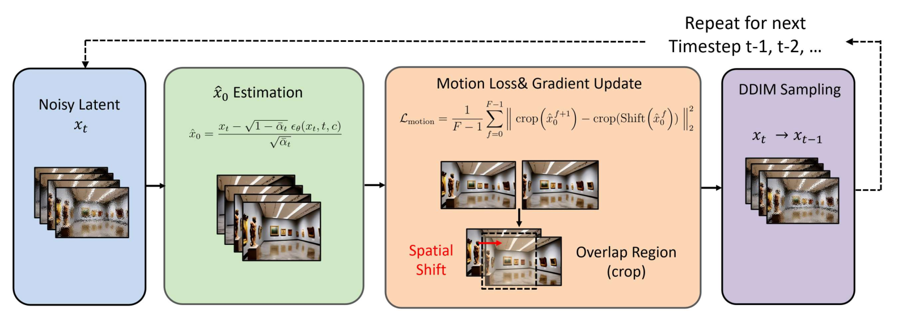

# Camera Motion Control in Video Diffusion Models via Temporal Consistency-Guided Latent Optimization

Ji-Hoon Choi, Han-Seul Lee, Se-In Choi, Byung-Gyu Kim\*
Dept. of IT Engineering, Sookmyung Women's University
*Korea Multimedia Society Spring Conference 2026 (KMMS Spring 2026), Vol. 29, No. 1* ([paper](https://drive.google.com/file/d/1DMB-QNSrEOK8v_eCPOpNZj18sMLP3mQx/view))

A **training-free** method that steers the camera motion of a text-to-video diffusion model (**pan left / pan right / tilt up / tilt down**) by optimizing the noisy latent at inference time. It needs no camera pose, trajectory, or optical-flow input, no extra control module, and no fine-tuning. The backbone is [VideoCrafter2](https://github.com/AILab-CVC/VideoCrafter), which this repository is built on.

## Results

**Pan left**: *"A modern glass office atrium with hanging lights and steel beams, photorealistic, highly detailed, 4k, camera panning left from the glass elevator lobby on the right to the reception area on the left"*



**Pan right**: *"A snowy alpine village at dawn with smoke rising from chimneys, crisp atmosphere, ultra-realistic, 4k, camera panning right from the wooden cottages on the left to the snow-covered chapel on the right"*



**Tilt up**: *"A breathtaking mountain range at sunrise, cinematic lighting, 4k, highly detailed, camera tilting up from the misty valleys below to the golden sky above"*



**Tilt down**: *"A grand train station with vaulted architecture and suspended clocks, photorealistic, highly detailed, 4k, camera tilting down from the arched glass roof to the crowded platform below"*



## Method



At each DDIM step `t`:

1. Estimate the clean latent with Tweedie's formula: `x̂₀ = (x_t − √(1−ᾱ_t)·ε_θ(x_t, t, c)) / √ᾱ_t`.
2. Compute a **shift-based latent consistency loss**. Frame `f` is shifted by `(shift_h, shift_w)`, both frames are cropped to their overlapping region (no wrap-around), and the loss is the MSE against frame `f+1`, averaged over all adjacent frame pairs.
3. Update the noisy latent with a normalized gradient: `x_t ← x_t − λ · ∇L / ‖∇L‖`.
4. Run a standard CFG DDIM step from the updated latent.

The optimization runs only during the **first 20 of 50 DDIM steps**, where global structure and motion form, with 3 gradient updates per step and λ = 40. The remaining steps are plain DDIM, which preserves visual quality.

| Motion | `shift_w` | `shift_h` | Content moves |
|---|:---:|:---:|---|
| Pan left | +1 | 0 | → right |
| Pan right | −1 | 0 | ← left |
| Tilt up | 0 | −1 | ↓ down |
| Tilt down | 0 | +1 | ↑ up |

Shifts are in latent pixels (one latent pixel equals 8 image pixels).

The implementation is in [`scripts/evaluation/inference_latent_opt.py`](scripts/evaluation/inference_latent_opt.py): see `calc_latent_shift_loss` and `custom_opt_ddim_sampling`.

## Setup

```bash
conda create -n videocrafter python=3.8.5
conda activate videocrafter
pip install -r requirements.txt
pip install opencv-python   # for evaluation
```

Download the [VideoCrafter2 T2V checkpoint (320×512)](https://huggingface.co/VideoCrafter/VideoCrafter2/blob/main/model.ckpt) to `checkpoints/base_512_v2/model.ckpt`.

## Usage

### Generate videos

```bash
# Proposed method: motion ∈ {pan_left, pan_right, tilt_up, tilt_down}
bash scripts/run_camera_motion.sh pan_left opt        # -> results/pan_left_opt_scale_40/
# Baseline with the same prompts / seed
bash scripts/run_camera_motion.sh pan_left base       # -> results/base_512_v2_pan_left/
# Different guidance strength λ
bash scripts/run_camera_motion.sh pan_right opt 30
```

Settings: seed 123, DDIM 50 steps, η = 1.0, CFG 12.0, fps 28, 320×512, 16 frames. Use `CUDA_VISIBLE_DEVICES` to select a GPU.

### Evaluate

```bash
python scripts/evaluation/evaluate_temporal_metrics.py \
    --input results/pan_left_opt_scale_40 --csv metrics/opt_pan_left_metrics.csv
python scripts/evaluation/summarize_metrics.py --metrics_dir metrics
```

The evaluation script uses these metrics:

- **WE (Warping Error):** the mean absolute error between frame `t` and frame `t−1` warped to it by optical flow.
- **TC (Temporal Consistency):** `1 − WE / raw frame difference`, which measures how well optical flow explains the frame-to-frame change.
- **Valid ratio:** the fraction of pixels that survive the in-bounds check and the forward-backward consistency check.

Optical flow is OpenCV Farneback by default (`--flow-method dis` is also available). No ground-truth video is needed.

### Make comparison figures

```bash
python scripts/evaluation/extract_concat_frames.py results/pan_left_opt_scale_40/0009.mp4 out.jpg
```

This saves the first, middle, and last frames side by side.

## Repository structure (additions to VideoCrafter)

```
prompts/{pan_left,pan_right,tilt_up,tilt_down}.txt   # 25 scene prompts per motion
scripts/run_camera_motion.sh                         # generation entry point (opt / base)
scripts/evaluation/inference_latent_opt.py           # proposed latent-optimization sampler
scripts/evaluation/evaluate_temporal_metrics.py      # WE / TC / valid ratio
scripts/evaluation/summarize_metrics.py              # aggregate CSVs -> Table 2
scripts/evaluation/extract_concat_frames.py          # qualitative figure helper
metrics/                                             # per-video metric CSVs used in the paper
assets/camera_control/                               # qualitative comparison figures
```

`scripts/evaluation/inference.py` (the baseline) is the original VideoCrafter script with only per-video timing logs added. The original VideoCrafter README is kept at [`docs/README_VideoCrafter.md`](docs/README_VideoCrafter.md).

## Citation

```bibtex
@inproceedings{choi2026cameramotion,
  title     = {Camera Motion Control in Video Diffusion Models via Temporal Consistency-Guided Latent Optimization},
  author    = {Choi, Ji-Hoon and Lee, Han-Seul and Choi, Se-In and Kim, Byung-Gyu},
  booktitle = {Proceedings of the Korea Multimedia Society Spring Conference},
  volume    = {29},
  number    = {1},
  year      = {2026}
}
```

Please also cite VideoCrafter2:

```bibtex
@misc{chen2024videocrafter2,
  title         = {VideoCrafter2: Overcoming Data Limitations for High-Quality Video Diffusion Models},
  author        = {Haoxin Chen and Yong Zhang and Xiaodong Cun and Menghan Xia and Xintao Wang and Chao Weng and Ying Shan},
  year          = {2024},
  eprint        = {2401.09047},
  archivePrefix = {arXiv}
}
```

## Acknowledgements and license

This work builds on [VideoCrafter](https://github.com/AILab-CVC/VideoCrafter) (Apache 2.0, see [License](License)).
